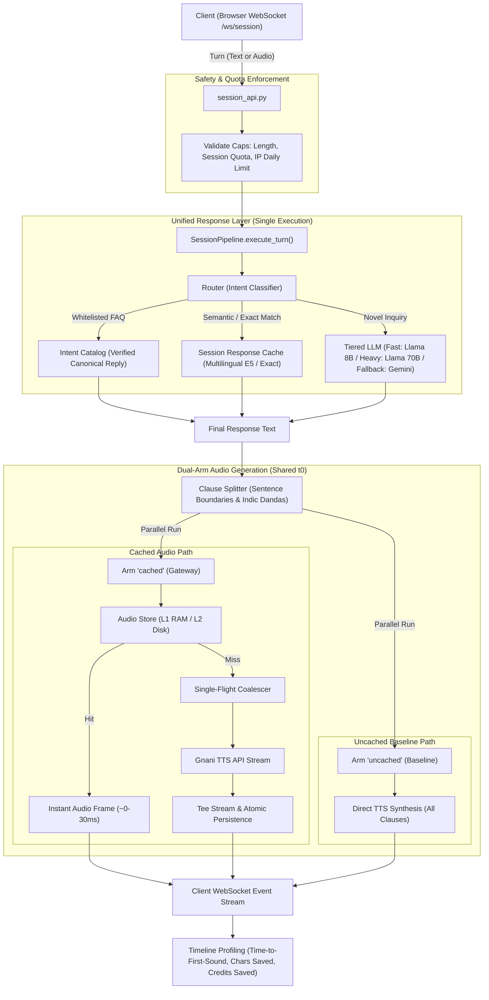

# CacheBuddy - Voice Gateway

High-Performance Semantic Response and Multi-Tier Audio Caching Layer for Conversational Voice Agents.

---

## Overview

In enterprise voice agent systems (such as utility helplines, banking IVRs, and customer support desks), callers repeatedly ask identical or semantically equivalent questions. Standard conversational pipelines transcribe every utterance, pass it to an LLM, and synthesize the complete response via text-to-speech (TTS).

This approach introduces two significant bottlenecks:
1. High Latency: Callers experience a multi-second delay waiting for STT, LLM inference, and full TTS audio synthesis before hearing the initial audio output.
2. Redundant Cloud and Model Spend: Fixed responses to recurring questions consume paid LLM tokens and character-based TTS quotas repeatedly.

CacheBuddy resolves this by introducing an intelligent routing, semantic text caching, and clause-level audio caching architecture with dual-arm verification to demonstrate quantifiable latency and cost reductions in real time.

---

## Architecture and Core Design Principles

The application is structured around a single-LLM, dual-TTS execution paradigm that eliminates evaluation bias:

1. Unified Text Generation: A turn executes the LLM step exactly once. Whether the response originates from an intent catalog, a semantic cache, or a fresh LLM call, both audio pathways receive identical text.
2. Concurrent Dual-Arm Execution:
   - Arm "cached" (Gateway): Performs clause-level audio lookups against an in-memory L1 cache and on-disk L2 store. Cache misses trigger single-flight coalesced synthesis, teeing streamed chunks directly to the caller while atomically persisting to storage.
   - Arm "uncached" (Baseline): Synthesizes every clause from scratch through the TTS provider without reading or writing to cache.
3. Indic-Aware Clause Splitting: Responses are parsed on natural punctuation boundaries and Indic dandas (`।`, `॥`). Clause 1 streams immediately to achieve sub-50ms time-to-first-sound, while subsequent clauses synthesize in the background.
4. Deterministic Guardrails: Hard SQLite budget caps and per-session quotas prevent runaway API spend.

---

## Request Flow Diagram



### Flow Walkthrough

```
[User Input: Text / Speech]
           |
           v
[Safety Caps & Guardrails] ---> (Cap Exceeded) ---> [Cap Notice / Audio Skipped]
           |
           v
[Router & Response Layer] (Unified LLM step, executed once)
   |-- 1. Intent Cache (whitelisted FAQ) -------> Canonical Reply Text
   |-- 2. Session Response Cache (E5 / Exact) ---> Cached Reply Text
   \-- 3. Tiered LLM (Groq Fast / Heavy / Gemini) -> Generated Reply Text
           |
           v
[Clause Splitter] (Splits on punctuation and Indic dandas: । ॥ . ? !)
           |
           +-------------------------------+-------------------------------+
           |                                                               |
           v                                                               v
   [Arm: Cached (Gateway)]                                        [Arm: Uncached (Baseline)]
   |-- 1. Audio Cache Lookup (L1 RAM / L2 Disk)                   \-- Direct TTS Synthesis
   |-- 2. Single-Flight Coalescing (for cache misses)                 (every clause, uncached)
   \-- 3. Tee-Streaming and Atomic File Persistence                        |
           |                                                               |
           v                                                               v
[Stream Clause 1 (~30ms)] --> [Subsequent Clauses]                [Full Synthesis Latency]
           |                                                               |
           +-------------------------------+-------------------------------+
                                           |
                                           v
                       [Comparative Metrics & Telemetry]
                 (Characters Saved, Credits Saved, Latency Delta)
```

---

## Key Components

### 1. Router and Intent Catalog
- Location: `backend/app/routing/router.py`, `backend/app/routing/intents.py`
- Fast regex matching and intent classification for domain-specific queries.
- Routes queries to `cached_intent`, `fast_llm` (`llama-3.1-8b-instant`), `heavy_llm` (`llama-3.3-70b-versatile`), or flags uncacheable personalized queries (`personalized`).

### 2. Semantic and Session Response Cache
- Location: `backend/app/cache/semantic.py`, `backend/app/pipeline/session.py`
- Embeddings: Uses `intfloat/multilingual-e5-small` normalized vectors with cosine similarity matching against a configurable threshold (`SEMANTIC_THRESHOLD`).
- Session Cache: Namespaced per session so each demo starts completely cold.
- Non-blocking Execution: Transformer forward passes run off the event loop via worker threads (`asyncio.to_thread`), preventing audio streaming stalls.
- Test Mocking: Configurable via `EMBEDDER=mock` for deterministic 64-dimensional test hashes without GPU/CPU overhead.

### 3. Audio Store (L1/L2 Cache)
- Location: `backend/app/cache/audio_store.py`, `backend/app/cache/keys.py`
- Cache Keys: Stable SHA-256 hashes generated from normalized speech text, voice identifier, language code, speech rate, sample rate, and version tag.
- Multi-tier Storage:
  - L1: Bounded in-memory LRU cache storing raw audio bytes.
  - L2: Persistent disk store with atomic write operations (temp file write followed by atomic rename) to prevent partial corruptions.

### 4. Single-Flight Coalescing and Tee Streaming
- Location: `backend/app/cache/singleflight.py`, `backend/app/cache/tee.py`
- Request Coalescing: When concurrent requests demand identical missing audio clauses, only one leader launches upstream TTS synthesis; followers subscribe to the leader's in-flight buffer.
- Tee Streamer: Splices the audio stream in real time to feed client delivery and atomic cache storage simultaneously.

### 5. Timeline Profiling
- Location: `backend/app/metrics/timeline.py`
- Precise monotonic clock tracking across all turn stages (`route`, `llm_cache_lookup`, `llm`, `tts`).
- Calculates:
  - `first_playable_ms`: Elapsed time from final reply text to the completion of clause 1 playback.
  - `total_ms`: Elapsed time until all clauses are fully playable.
  - `unattributed_ms`: Total turn duration minus the union of individual span intervals.

### 6. Guardrails and Budget Controls
- Location: `backend/app/budget.py`, `backend/app/session_api.py`
- Pre-allocated credit tracking across isolated SQLite buckets.
- Per-request character limits, per-session quotas, and per-IP daily caps.
- Emergency Kill Switch (`KILL_SWITCH=1`): Disables live TTS synthesis immediately; cached responses continue to serve at zero marginal cost.

---

## Repository Layout

```
.
|-- backend/
|   |-- app/
|   |   |-- adapters/          # Gnani TTS/STT, Groq/Gemini LLM, and offline mock adapters
|   |   |-- audio.py           # WAV header repair (fixing streaming 0xFFFFFFFF size fields)
|   |   |-- budget.py          # SQLite pre-flight credit reservation and quota tracking
|   |   |-- cache/             # Audio store (L1/L2), keys, semantic cache, singleflight, tee
|   |   |-- config.py          # Pydantic BaseSettings environment configuration
|   |   |-- main.py            # FastAPI entrypoint, lifespan loader, and static mounts
|   |   |-- metrics/           # Recorder, SQLite telemetry store, timeline span profiler
|   |   |-- pipeline/          # Baseline, gateway, and dual-arm session pipeline
|   |   |-- routing/           # Router, intent catalog, Indic clause splitter
|   |   |-- session_api.py     # Session HTTP and WebSocket endpoint (/ws/session)
|   |   \-- static/            # Frontend dashboard, session.html, session.js, styles.css
|   |-- tests/                 # Unit, integration, and performance tests
|   |   |-- conftest.py        # Test configuration enforcing EMBEDDER=mock
|   |   |-- test_audio.py      # Audio processing and header tests
|   |   |-- test_budget.py     # Budget reservation and bucket cap tests
|   |   |-- test_cache.py      # Key stability, LRU eviction, and atomic store tests
|   |   |-- test_embedder_real.py # Integration test for real sentence-transformers model
|   |   |-- test_pipelines.py  # Baseline vs Gateway pipeline execution tests
|   |   |-- test_router_rules.py # Intent catalog routing rule tests
|   |   |-- test_routing.py    # Language detection and classification tests
|   |   |-- test_session.py    # Session pipeline timing, waterfall, and savings tests
|   |   |-- test_session_api.py # WebSocket protocol and turn streaming tests
|   |   |-- test_singleflight.py # Concurrent leader/follower coalescing tests
|   |   \-- test_tee.py        # Stream teeing and simultaneous write tests
|   |-- requirements.txt       # Full local dependencies (including PyTorch & SentenceTransformers)
|   |-- requirements-render.txt# Slim deployment dependencies (for containerized hosts)
|   \-- pytest.ini             # Pytest configuration
|-- bench/                     # Automated benchmarking scripts and Zipf workload generators
|-- data/
|   |-- eval_set.jsonl         # Multilingual benchmark evaluation test cases
|   \-- intents.yaml           # Intent catalog definitions with multilingual examples
|-- notes/                     # Architectural decisions and benchmark findings
\-- scripts/                   # Evaluation, calibration, and live probe utilities
```

---

## Setup and Execution

### 1. Environment Preparation
Ensure Python 3.11+ is installed. Create and activate a virtual environment:

```bash
python -m venv .venv

# Windows PowerShell:
.\.venv\Scripts\Activate.ps1

# Linux / macOS:
source .venv/bin/activate
```

Install dependencies:
```bash
# Full local installation (includes sentence-transformers for local inference):
pip install -r backend/requirements.txt

# Or lightweight installation (for fast cloud deployment with mock embedder):
pip install -r backend/requirements-render.txt
```

### 2. Environment Configuration
Create a `.env` file in the root directory (or configure environment variables):

```ini
# Gateway Configuration
MOCK_APIS=1
EMBEDDER=mock
SEMANTIC_THRESHOLD=0.82
SESSION_SEMANTIC_THRESHOLD=0.88

# Live Provider Keys (optional when MOCK_APIS=1)
GNANI_API_KEY=
GROQ_API_KEY=
GEMINI_API_KEY=
```

### 3. Run the Test Suite
All core tests run completely offline and verify exact timing bounds without spending live API credits:

```bash
python -m pytest backend/tests -v
```

To run the real sentence-transformer embedding verification test:
```bash
python -m pytest backend/tests/test_embedder_real.py -v
```

### 4. Start the Application Server
Run the FastAPI application via Uvicorn:

```bash
# Set PYTHONPATH to include the backend directory:
# Windows PowerShell:
$env:PYTHONPATH="backend"
python -m uvicorn app.main:app --host 0.0.0.0 --port 8000 --reload

# Linux / macOS:
PYTHONPATH=backend python -m uvicorn app.main:app --host 0.0.0.0 --port 8000 --reload
```

Open your browser to:
- Session Benchmarking UI: `http://localhost:8000/session`
- System Health Check: `http://localhost:8000/api/health`
- Supported Intents Catalog: `http://localhost:8000/api/intents`
